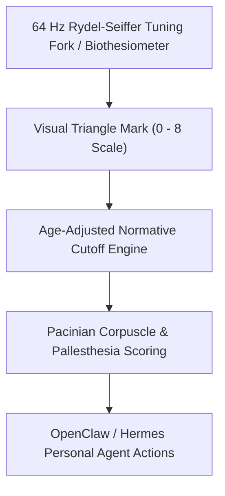

# Cutaneous Vibration Perception Threshold (VPT) Skill

[](LICENSE)
[](https://www.python.org/)
[](requirements.txt)
[](mcp_server.py)
[](SKILL.md)

Zero-dependency sovereign personal agent skill for non-invasive evaluation of Cutaneous Vibration Perception Threshold (VPT), Rydel-Seiffer tuning fork pallesthesia, and large-fiber sensory neuropathy.



## Features
- **Deterministic Math**: Pure Python standard library implementation with zero external dependencies.
- **Clinical Neurological Standards**: Implements validated age-dependent Rydel-Seiffer cutoff formulas.
- **Hand-Arm Vibration & Large-Fiber Screening**: Non-invasive assessment of Pacinian mechanoreceptive integrity.
- **Model Context Protocol (MCP)**: Native JSON-RPC tool integration for LLMs and autonomous agents.

## Quickstart

```python
from client import VibrationPallesthesiaClient

client = VibrationPallesthesiaClient()
result = client.evaluate_vibration_threshold(
    rydel_seiffer_reading=7.5,
    age_years=32.0
)
print("Pallesthesia Score:", result["pallesthesia_sensory_score"])
print("Classification:", result["classification"])
```

## License
Apache-2.0
